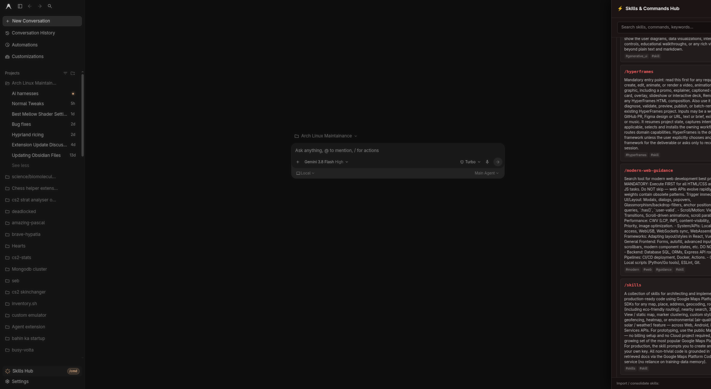
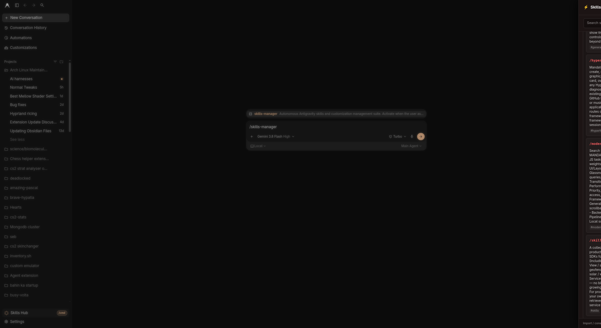
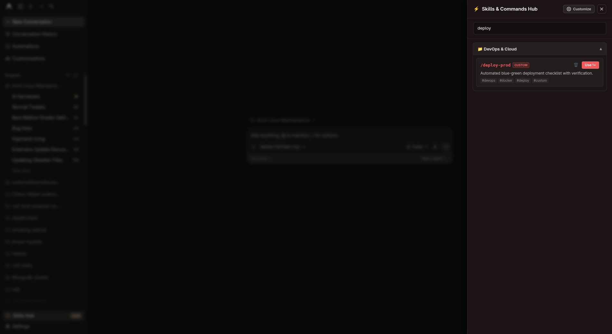

# ⚡ Antigravity Skills Hub & Autonomous Skills Manager

[](https://opensource.org/licenses/MIT)
[](https://antigravity.google)
[](https://python.org)
[]()
[]()

> **The definitive skill discovery, import, consolidation, and slide-out navigation engine for Google Antigravity (Antigravity 2.0 / Antigravity IDE).**  
> Browse all installed skills from an integrated sidebar drawer, automatically import skills from GitHub or Obsidian, and consolidate multi-skill suites with zero loss of prompt rules.

<p align="center">
  
</p>

<p align="center">
  <a href="assets/showcase.mp4">▶️ <b>Watch 17s High-Definition Video (1080p with Audio)</b></a> &nbsp;•&nbsp; 
  <a href="assets/showcase-60s-luxury.mp4">✨ <b>Watch 60s Extended Luxury Edition</b></a>
</p>

---

## 📸 Visual Showcase

### 🗂️ Slide-Out Skills Hub Drawer (Categorized & Searchable)


### 🤖 Autonomous `/skills-manager` Agent Command


### 🔍 Instant Keyword Search & Domain Filtering


---

## ✨ Key Features

- **🗂️ Integrated Slide-Out Skills Hub Drawer:** Embedded directly into the Antigravity sidebar (`Skills Hub [/cmd]`), featuring categorized domain accordions (3D Modeling, AI APIs, Testing, Development, UI/UX, Workflow).
- **📋 1-Click Prompt Insertion & Clipboard Copy:** Click `Use ↳` to instantly copy any slash command to clipboard and insert it into the active chat prompt with **no trailing whitespace**.
- **🤖 Autonomous `/skills-manager` Agent Skill:** Instruct your AI pair programmer directly in chat to scan your system, import new skills from GitHub, or consolidate complex tools.
- **📥 Universal Skill Importer:**
  - **From GitHub:** Automatically clones repositories and parses `SKILL.md`.
  - **From Obsidian Vaults:** Copies markdown guidelines from your personal notes into active agent skills.
  - **From Raw URLs / Gists:** Downloads markdown files and generates valid YAML frontmatter.
  - **Automatic Symlinking:** Immediately registers imported skills in `~/.gemini/config/skills/` and profile homes.
- **📦 Zero-Loss Multi-Skill Consolidation ("Clubbing"):**
  - Consolidate fragmented multi-skill suites (e.g. 7 Blender skills, 7 Stitch skills, 6 Roblox skills) into single high-efficiency master skills.
  - Preserves 100% of internal prompt instructions and rulesets verbatim in `modules/<sub-skill>/guide.md`.
  - Frees up room in Antigravity's slash command limits while retaining all sub-capabilities.
- **🔄 Live Hot-Reloading via Chrome DevTools Protocol (CDP):** Syncs and updates the Skills Hub drawer in running Electron instances live via WebSocket with zero app restarts.
- **🛠️ Automated App Patcher (`patch_app_asar.py`):** Cleanly repacks `app.asar` to bake the Skills Hub into Electron's preload script, fix sidebar scrollbars, and eliminate the startup white flash.

---

## ⚡ Quick Installation

### Option 1: One-Line Automatic Install (Recommended)

```bash
git clone https://github.com/ypatil2006-coder/antigravity-skills-hub.git ~/.config/antigravity-skills-hub
cd ~/.config/antigravity-skills-hub
chmod +x install.sh manage_skills.py
./install.sh
```

### Option 2: Manual Installation

1. **Clone the repository:**
   ```bash
   git clone https://github.com/ypatil2006-coder/antigravity-skills-hub.git
   cd antigravity-skills-hub
   ```

2. **Install the CLI binary:**
   ```bash
   mkdir -p ~/.local/bin
   ln -sf "$(pwd)/manage_skills.py" ~/.local/bin/manage-skills
   chmod +x manage_skills.py
   ```

3. **Install the `/skills-manager` agent skill:**
   ```bash
   mkdir -p ~/.agents/skills/skills-manager ~/.gemini/config/skills
   cp skills/skills-manager/SKILL.md ~/.agents/skills/skills-manager/SKILL.md
   ln -sf ~/.agents/skills/skills-manager ~/.gemini/config/skills/skills-manager
   ```

4. **Sync installed skills & build catalog:**
   ```bash
   python3 manage_skills.py sync
   ```

5. **Patch Antigravity `app.asar` (Optional for native sidebar drawer):**
   ```bash
   python3 patch_app_asar.py
   ```

---

## 🛠️ CLI Usage & Flags (`manage-skills` / `manage_skills.py`)

```bash
# Scan and list all installed skills across all locations
manage-skills scan

# Sync skills to catalog, daemon, and live Antigravity GUI
manage-skills sync

# Also repack app.asar during sync
manage-skills sync --repack

# Import a skill from a GitHub repository
manage-skills import https://github.com/owner/skill-repo --name my-skill

# Import a skill from an Obsidian Vault or local folder
manage-skills import "/path/to/Obsidian Vault/SkillFolder" --name my-skill

# Import from a raw markdown URL
manage-skills import "https://raw.githubusercontent.com/.../SKILL.md" --name my-skill

# Club multiple fragmented skills into a unified consolidated suite
manage-skills club blender blender-modeling blender-lighting blender-export
```

---

## 💬 Conversational Agent Usage

Because `skills-manager` is installed as an agent skill, you don't even need to use the terminal. You can simply instruct your Antigravity agent in chat:

- *"Sync all my installed skills into the Skills Hub drawer"*
- *"Import the tailwind-v4 skill from https://github.com/example/tailwind-skill"*
- *"Import my canvas design skill from my Obsidian vault"*
- *"Club all my separate docker skills into a single devops master suite"*

The agent will execute `manage_skills.py`, create the required symlinks, and refresh the UI automatically.

---

## 🧩 Architecture & Discovery Pipeline

```
┌─────────────────────────────────────────────────────────────────────────────┐
│                       ANTIGRAVITY SKILLS DISCOVERY                          │
│                                                                             │
│  User Skills (~/.agents/skills/*)                                            │
│  Plugin Skills (~/.gemini/config/plugins/*/skills/*)                         │
│  Built-in Skills (~/.gemini/antigravity-cli/builtin/skills/*)                 │
└──────────────────────────────────────┬──────────────────────────────────────┘
                                       │
                                       ▼
┌─────────────────────────────────────────────────────────────────────────────┐
│                          manage_skills.py ENGINE                            │
│                                                                             │
│  1. Scan & Parse YAML frontmatter (name, description, tags)                 │
│  2. Semantic Domain Matcher (3D, AI, Testing, Dev, UI/UX, Workflow)        │
│  3. Multi-Skill Consolidation Protocol (modules/<sub-skill>/guide.md)       │
│  4. Symlink Orchestrator (~/.gemini/config/skills & Antigravity-Profiles)   │
└──────────────────────────────────────┬──────────────────────────────────────┘
                                       │
                         ┌─────────────┴─────────────┐
                         ▼                           ▼
┌──────────────────────────────────┐   ┌──────────────────────────────────┐
│        SKILLS HUB DRAWER         │   │      /skills-manager SKILL       │
│                                  │   │                                  │
│  • Collapsed domain accordions   │   │  • Autonomous agent instructions │
│  • Instant search & tag filter   │   │  • Git / Obsidian / URL imports  │
│  • 1-Click zero-space insert     │   │  • Rule-preserving consolidation │
│  • Hot-reload via CDP WebSocket  │   │  • Cross-account profile sync    │
└──────────────────────────────────┘   └──────────────────────────────────┘
```

---

## 🤝 Contributing

Contributions, issues, and feature requests are welcome! Feel free to check the [issues page](https://github.com/ypatil2006-coder/antigravity-skills-hub/issues).

---

## 📜 License

Distributed under the [MIT License](LICENSE).
